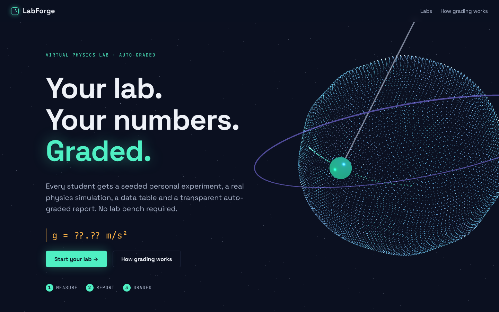

# LabForge

**A personal virtual physics lab that grades itself.** Every student gets a seeded experiment with hidden constants, a real physics simulation, a data table, and a lab report that is auto-graded by readable formulas.



## The problem
Many students have little or no access to a physical lab bench. Free simulations exist (for example PhET), but they are mostly open sandboxes: every student sees the same values, and there is no guided procedure or assessment built in.

## What LabForge adds
1. **A seeded personal instance.** Your name/ID creates hidden constants (your "world's" gravity, a resistor value), different for each student.
2. **Guided experiments.** Pendulum, Ohm's law, projectile: set parameters, take measurements with realistic noise, fill the data table, choose graph axes.
3. **Transparent auto-grading.** Accuracy, consistency with your own data, graph choice and fit quality (R²), units, significant figures and method checks. 100 points, every formula shown at `#/about`.

Everything runs in the browser. No backend, no paid API, no account. Data stays in `localStorage`.

## Run it
```bash
python3 -m http.server 8000   # then open http://localhost:8000
node tests/run.mjs            # physics, units, grading tests (no dependencies)
```
Open `/?nogl` to force the no-WebGL fallback.

## Tech
Vanilla ES modules, Three.js (3D hero scene), GSAP (motion), 2D canvas bench and graphs, Space Grotesk and JetBrains Mono (self-hosted). Physics: semi-implicit Euler at a fixed 1/240 s step (nonlinear pendulum, drag-free projectile, noisy ohmic meter). Deterministic noise streams per (seed, trial) so a repeated trial reproduces.

## Grading at a glance
| Part | Pts |
|---|---|
| Accuracy (% error to hidden truth) | 35 |
| Matches your own data | 10 |
| Graph choice + R² | 20 |
| Units | 10 |
| Significant figures | 10 |
| Method (5 checks) | 15 |

## Limitations (honest list)
- Simplified physics: no air drag, ideal instruments.
- The share-link checksum deters casual edits; it is not tamper-proof (no server).
- Three experiments only; the conclusion answers are present in client code.
- English UI today; all strings are in `js/i18n.js` for translation.

## AI disclosure
Built with AI assistance (Claude). Architecture, grading formulas and tests were specified and reviewed; every formula is documented in `docs/DESIGN-SPEC.md` and exercised by `tests/run.mjs`.

## Credits
Three.js (MIT), GSAP (standard license), Space Grotesk and JetBrains Mono (OFL). Licensed MIT.
